<!-- Generated gallery assets: python3 tools/build_assets.py -->

<picture>
  <source media="(max-width: 500px) and (prefers-color-scheme: dark)" srcset="./assets/profile/intro-compact-dark.svg">
  <source media="(max-width: 500px)" srcset="./assets/profile/intro-compact-light.svg">
  <source media="(prefers-color-scheme: dark)" srcset="./assets/profile/intro-dark.svg">
  
</picture>

Pre-medical student from **Brazil**, making focused Anki add-ons that make studying feel a little easier.

I enjoy AI, automation, and thoughtful tools.

[AnkiWeb](https://ankiweb.net/shared/by-author/1011095603) &nbsp; · &nbsp; [Discord](https://discord.gg/h4bYatgh44) &nbsp; · &nbsp; [GitHub](https://github.com/thepeacemonk)

 

## Anki add-ons

<a href="https://ankiweb.net/shared/info/1011095603">
<picture>
  <source media="(prefers-color-scheme: dark)" srcset="./assets/cards/onigiri-dark.svg">
  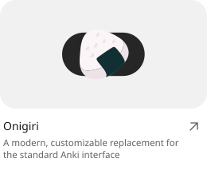
</picture>
</a>

<a href="https://ankiweb.net/shared/info/516325516">
<picture>
  <source media="(prefers-color-scheme: dark)" srcset="./assets/cards/focumon-dark.svg">
  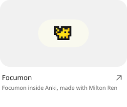
</picture>
</a>

<a href="https://ankiweb.net/shared/info/1799253175">
<picture>
  <source media="(prefers-color-scheme: dark)" srcset="./assets/cards/lofitown-dark.svg">
  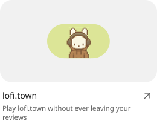
</picture>
</a>

<a href="https://buymeacoffee.com/peacemonk/extras/125639">
<picture>
  <source media="(prefers-color-scheme: dark)" srcset="./assets/cards/league-dark.svg">
  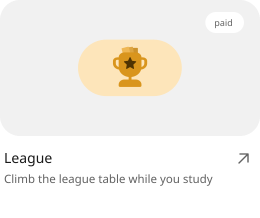
</picture>
</a>

<a href="https://ankiweb.net/shared/info/585575504">
<picture>
  <source media="(prefers-color-scheme: dark)" srcset="./assets/cards/senchado-dark.svg">
  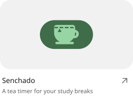
</picture>
</a>

<a href="https://ankiweb.net/shared/info/1803057887">
<picture>
  <source media="(prefers-color-scheme: dark)" srcset="./assets/cards/paper-dark.svg">
  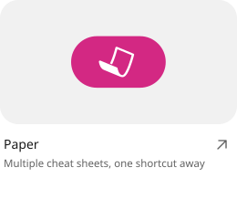
</picture>
</a>

<a href="https://ankiweb.net/shared/info/629799722">
<picture>
  <source media="(prefers-color-scheme: dark)" srcset="./assets/cards/sticky-dark.svg">
  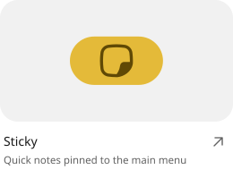
</picture>
</a>

<a href="https://ankiweb.net/shared/info/643961895">
<picture>
  <source media="(prefers-color-scheme: dark)" srcset="./assets/cards/power-dark.svg">
  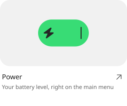
</picture>
</a>

<a href="https://ankiweb.net/shared/info/691162538">
<picture>
  <source media="(prefers-color-scheme: dark)" srcset="./assets/cards/hours-dark.svg">
  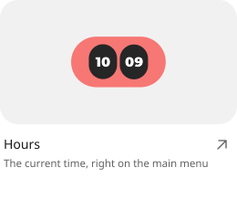
</picture>
</a>

<a href="https://ankiweb.net/shared/info/519723565">
<picture>
  <source media="(prefers-color-scheme: dark)" srcset="./assets/cards/global-dark.svg">
  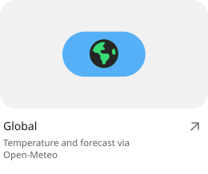
</picture>
</a>

<a href="https://ankiweb.net/shared/info/73838120">
<picture>
  <source media="(prefers-color-scheme: dark)" srcset="./assets/cards/berry-dark.svg">
  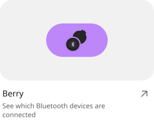
</picture>
</a>

<a href="https://ankiweb.net/shared/info/1844248422">
<picture>
  <source media="(prefers-color-scheme: dark)" srcset="./assets/cards/fixcaps-dark.svg">
  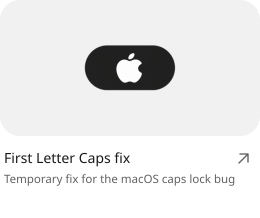
</picture>
</a>

 

## Other projects

<a href="https://github.com/thepeacemonk/Stacked-Library">
<picture>
  <source media="(prefers-color-scheme: dark)" srcset="./assets/cards/stacked-library-dark.svg">
  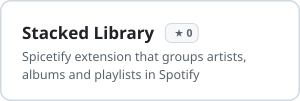
</picture>
</a>

<a href="https://github.com/thepeacemonk/Little-Cats-Explain">
<picture>
  <source media="(prefers-color-scheme: dark)" srcset="./assets/cards/little-cats-dark.svg">
  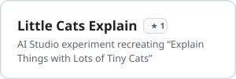
</picture>
</a>

<a href="https://github.com/thepeacemonk/Highlightr-Enhanced">
<picture>
  <source media="(prefers-color-scheme: dark)" srcset="./assets/cards/highlightr-dark.svg">
  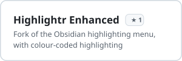
</picture>
</a>

 

## In the oven

<picture>
  <source media="(prefers-color-scheme: dark)" srcset="./assets/cards/astra-dark.svg">
  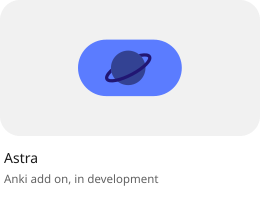
</picture>

<picture>
  <source media="(prefers-color-scheme: dark)" srcset="./assets/cards/8bitdo-dark.svg">
  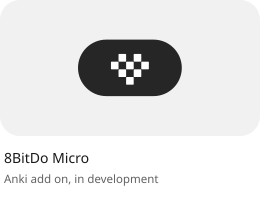
</picture>

<picture>
  <source media="(prefers-color-scheme: dark)" srcset="./assets/cards/webapp-dark.svg">
  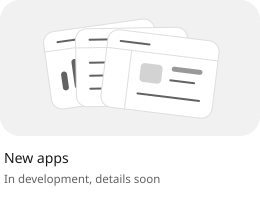
</picture>

